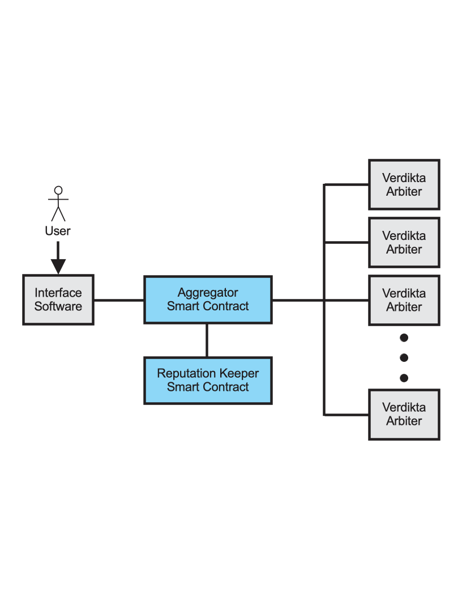

# Verdikta User's Guide: AI-Powered Evaluations for Smart Contracts

**Version Beta-1**

!!! info "What this guide was checked against"
    Revised on 2026-11-22 against the `ReputationAggregator` and `ReputationKeeper` contracts in [verdikta-dispatcher](https://github.com/verdikta/verdikta-dispatcher/tree/master/reputationBasedAggregator/contracts) and against the aggregator deployed on Base mainnet at [`0xd8F38bCBEE43bE3bd31655a563f20c9B3e67142a`](https://basescan.org/address/0xd8F38bCBEE43bE3bd31655a563f20c9B3e67142a). Fees are paid in ETH. The numbers in this guide are settings that the contracts' owner can change: each one is given with the contract function that returns the current value, so you can check it yourself.

## Introduction

Verdikta brings trustless AI to blockchain applications. It enables smart contracts and decentralized applications (dApps) to request AI evaluations (for example, for dispute resolutions or content analysis) that are decided collectively by multiple random AI agents called "arbiters" that are incentivized for accuracy. Using Verdikta, developers can integrate complex AI reasoning into on-chain logic without relying on a centralized service. This guide walks you through the concepts and steps to use Verdikta, from understanding the underlying technologies to the process of requesting and retrieving results. We'll cover the basics of smart contracts, Chainlink oracles, and IPFS, explain how Verdikta works, and give code examples in Solidity and JavaScript to help you get started.

## Background Concepts

Before diving into Verdikta details, it's important to understand its underlying technologies: smart contracts, Chainlink oracles, and IPFS. If you're already familiar with these, feel free to skip ahead. For those less familiar, here is a brief overview.

### Smart Contracts

Smart contracts are self-executing programs that run on a blockchain. They enforce rules and agreements in code without manual oversight. Once deployed, a smart contract's code is tamper-proof and transparent: it always executes as written when its functions are called. This enables trustless execution of transactions—such as holding funds in escrow and releasing them based on predefined conditions. However, by default smart contracts only have access to on-chain data. They cannot directly access external information (like web API data or AI computations) on their own. This is where oracles come in.

### Chainlink Oracles and Decentralized Trust

Oracles bring external information into the blockchain. Chainlink is a well-known decentralized oracle network that connects smart contracts to off-chain data and computation. Oracles act as bridges, feeding the external information into the blockchain in a secure and reliable way. A Chainlink oracle network consists of many independent node operators that fetch or compute data and reach consensus on the result, which is then delivered on-chain for use by smart contracts. This decentralized design is crucial because having to trust a single oracle operator, what in Verdikta is called an *arbiter*, would undermine the trustless nature of smart contracts. In this document, "trustless" means not having to trust a single entity.

For example, Chainlink Data Feeds can aggregate price data from many sources to provide tamper-resistant price oracles in DeFi. Similarly, Chainlink can be used to connect AI models to smart contracts. Rather than trusting a single AI API, an oracle network can call multiple AI models or services and aggregate their responses. This increases reliability: if one model is wrong or biased, the others can outvote it. Verdikta leverages this principle by having multiple AI arbiters evaluate each query using multiple AI algorithms and intelligently combining all the results.

### IPFS

IPFS (InterPlanetary File System) is a decentralized file storage and sharing network. It allows data (like documents, images, or JSON blobs) to be stored broadly and referenced by a unique cryptographic hash, called a CID (standing for Content Identifier). Unlike a traditional URL that points to a location on a specific server, a CID is a signature that points to content itself, which can be stored anywhere, or in multiple places. So, IPFS provides a content-addressable, peer-to-peer method for storing and sharing data. In practice, this means if you have some data (for example, a text description of a dispute or a query for an AI model), you can add it to IPFS and share only its CID. Then anyone with that CID can retrieve the data from the IPFS network knowing it is unchanged because if the content were changed in any way it would give a different CID.

Verdikta uses IPFS to handle the often large amounts of data associated with AI evaluations. Instead of putting a whole essay or case description on the blockchain (which would be expensive and impractical), the user provides a comparatively short (100 or fewer characters) CID pointing to the data on IPFS. The arbiters fetch the content from IPFS off-chain, evaluate it with AI, and then similarly store any detailed justifications or responses back to IPFS. The smart contract only needs to handle CIDs. Using IPFS in this way keeps Verdikta's on-chain footprint small while maintaining decentralization (the data isn't reliant on a single server) and integrity (information is addressed by its content, so everyone can be sure of getting the correct data).

## Trustless AI for Smart Contracts

Trustless AI refers to the ability to incorporate AI-driven decisions without having to trust a single AI provider. The goal is to get on-chain AI results that are accurate and manipulation-resistant. This is a new frontier because leading AI models are typically run on centralized servers. Verdikta's approach is to decentralize the evaluation process: multiple independent AI agents (the arbiters) evaluate a query, with the results combined on-chain in a smart contract called the Aggregator using rules that incentivize honesty and accuracy. In addition to a base fee paid to all participating arbiters, bonuses are paid to the arbiters that respond quickly and accurately, as determined by clustering results. A separate special smart contract, the Reputation Keeper, maintains timing and quality reputation scores for the arbiters and uses these to increase the chances of selection for future queries. The organization of the Verdikta system is illustrated in the figure below.



The benefits of this approach include the following:

- **Reliability and Accuracy:** By aggregating outputs from multiple AI models and instances, which different entities can operate on different platforms, Verdikta reduces the risk of failure and inaccuracy. The arbiter network consensus approach means the final result represents broader agreement. The system "crowd-verifies" the answer.

- **No Single Trusted Party:** Users do not have to trust any one person or entity. The arbiters are decentralized and chosen at random for each query, and their outputs are combined in a smart contract. Even if one arbiter is malicious or faulty, it will be outweighed by others.

- **Verifiability:** The code and output for the smart contracts is public, and anyone can verify that the process (random selection, funds commitment, response validity, scoring) was followed correctly. While the AI reasoning process is off-chain, multiple random nodes agreeing on the output provides validation.

- **Incentive Alignment:** Verdikta incorporates a reputation and staking system (discussed in detail later in this document) to economically motivate honest behavior. The AI arbiters are held accountable for the quality of their outputs via reputation scores and penalties and rewards. Incentives—where providers are rewarded or penalized based on the quality of their data—are vital for a trustless system.

In summary, Verdikta's trustless AI mechanism allows smart contracts to confidently use AI-generated decisions (like "Who wins this dispute?" or "Is this content acceptable?") knowing that the answer was derived in a decentralized, tamper-resistant way. With these concepts in mind, let's next look at how Verdikta itself is structured and how to use it.

## The Verdikta System 

Verdikta uses multiple logical components. On-chain there is the Aggregator's combinatorial logic and the Reputation Keeper's staking and reputation-management mechanism for arbiters. Off-chain, there are many instances of software—variously owned and operated—that perform the actual AI computations. Let's break down the roles and the flow of an evaluation request.

### Components

- **User (Requester):** This is you (or your smart contract) requesting an AI evaluation. For example, you might be developing a dApp that needs an AI to score a piece of content or resolve a dispute between two parties. Typically, the user formulates the query and stores it on IPFS before calling the Verdikta contract to start an evaluation.

- **Aggregator Contract:** This is the core Verdikta smart contract deployed on-chain. It coordinates the process. Its responsibilities include the following: receiving evaluation requests, selecting a set of arbiters to handle each request, collecting their responses through a commit-reveal process, aggregating the results (e.g. computing an average score or majority vote), and updating arbiters' reputations. You interact directly with this contract to request evaluations and fetch results.

- **Reputation Keeper Contract:** The Aggregator contract relies on a separate Reputation Keeper contract to do its job. This smart contract executes the Stake and Reputation System. Each arbiter has skin in the game. Arbiters stake Verdikta tokens to register with the Reputation Keeper (on Base, 100 of the wrapped token wVDKA per arbiter). An arbiter whose scores fall too far cannot withdraw that stake for a time and is left out of selection; the contract can also take part of the stake, an amount that is set to zero on Base mainnet today (see [Reputation Tracking](#reputation-tracking)). The reputation scores measure past performance. If an arbiter consistently responds quickly and agrees with the consensus result, its reputation scores go up; if an arbiter deviates or fails to respond, its reputation scores go down. The Reputation Keeper uses timeliness and quality ratings for each arbiter to decide eligibility to participate and to determine likelihood of selection in queries. The use of staking and reputation scoring creates an incentive structure where arbiters are motivated to provide truthful, high-quality answers.

- **AI Arbiters:** These are Verdikta logical nodes (Chainlink nodes working with other software) running AI models. Each arbiter is uniquely identified by a combination of 1) an operator smart contract address and 2) a Chainlink Job ID. An operator registers this identifier pair with the Verdikta network by staking 100 Verdikta tokens (`STAKE_REQUIREMENT` in the Reputation Keeper; on Base the staked token is the wrapped token wVDKA). Arbiters each have two reputation scores that are tracked. One is for timeliness and the other is for quality. When a new request comes in, a subset of all registered arbiters is randomly selected using blockchain and arbiter-generated entropy to process the query. The randomness used in the Verdikta commit-reveal process is incorporated into rolling entropy: this lets Verdikta requests add 80 new bits of randomness that future selections can't predict. Each selected arbiter retrieves relevant query data from an IPFS node (using the CID provided), runs AI models to evaluate it, and produces an output in the form of numerical scores (the decision) and a textual justification explaining the reasoning. The justification is uploaded to IPFS by the arbiter, yielding a content-hash CID for conveying the explanation text. The arbiter submits its score and the justification CID back to the ReputationAggregator contract as its answer.

- **Verdikta Payment:** Verdikta's services are not free—users must pay in cryptocurrency for each AI evaluation request. This fee rewards the arbiters and compensates for their costs (e.g., compute, blockchain access, AI access, and data storage/retrieval). The fee is paid in ETH, the native currency of Base. You send the ETH with the call to `requestAIEvaluationWithApproval()`: the amount is a worst-case budget that the contract's `maxTotalFee()` function returns, and whatever a round does not spend is credited back to you. The function keeps its historical name, but there is no token approval and you need no LINK: Chainlink is still how requests reach the arbiters, and those requests carry no LINK payment. We will see how to handle this in the usage section.

### How an Evaluation Request Works (Lifecycle)

Here is a step-by-step outline of what happens when you request an AI evaluation on Verdikta:

1. **Query Preparation:** The user prepares the query data and stores it on IPFS, obtaining a content hash, the CID. The query takes the form of comma-delimited CIDs followed by optional colon-delimited text. Here is the pattern: `CID1,CID2,…,CIDN:TEXT`.

2. **Query CID Details:** The first CID in the query represents data in the following form: It is a zipped directory holding files, one of which is named `manifest.json`. This JSON manifest file holds 1) a version number, 2) a name for the primary file describing the query, 3) jury parameters including which AI models to query and how to weight them, and 4) a list of supporting files. Additional CIDs can hold additional supporting files. Often just one CID will be used, while the optional use of multiple CIDs allows data to originate at different times and from different sources, which is useful for some applications.

3. **Request Submission (On-Chain):** The user calls the Aggregator contract's function `requestAIEvaluationWithApproval()` to initiate the request. This call sends the CIDs and the optional text field to initiate the process. The same transaction carries the ETH that pays for the evaluation (see the coding section for how to size it). At this moment the contract credits each selected arbiter's owner with that arbiter's base fee. The contract emits a blockchain event (`RequestAIEvaluation`) containing a unique request ID (needed for coordination with future communication) and the query data.

4. **Use of Multiple AI Engines:** With Verdikta, any number of AI types can be requested with any number of calls made to each. The ability to interact with a particular AI model type is determined by the arbiter's 64-bit *class*, with some classes able to use frontier models from, for example, OpenAI and Anthropic, while others are able to run open source models. Some arbiters can handle multiple classes. A request names one class, and the models listed in its manifest should come from that class's pool; the pools are listed in the [ClassID usage guide](https://docs.verdikta.org/verdikta-common/CLASSID_USAGE_GUIDE/). Every arbiter selected for a request is asked to run the same models, the ones the manifest names.

5. **Arbiter Selection (Random & Trustless):** When the request is received, the Reputation Keeper generates a random seed based on blockchain- and arbiter-supplied entropy. Using this randomness, it selects a set of arbiters from the pool of available, staked arbiters that support the requested class. The selection gives higher-weighted chances to those arbiters with better reputations. The Aggregator contract forwards the query as part of a commit-reveal process to the chosen arbiters.

6. **Commit-Reveal Process:** The Aggregator interacts with the arbiters in two steps. First it makes a request to a number of arbiters, nominally six, to process the query with AI but not return the result immediately. Instead the arbiters are asked to provide a cryptographic hash of the results combined with a random salt. This serves as a commitment. The exact form of the hashed commitment is the following: 
   ```solidity
   bytes16 hash = bytes16(sha256(abi.encode(senderAddress, likelihoods, salt)))
   ```
   Once a specified number, nominally four, respond with a commitment of this form, those are then asked to reveal their AI results. This two-step process prevents a rogue arbiter from just copying the answer of another arbiter. A common identifier, called the aggregation ID, is used with all interactions for the same user query.

7. **Off-Chain Evaluation:** Each selected arbiter has software running on Internet-connected hardware. This software sees that it has been picked for processing with a given query package. Content is downloaded from IPFS using the provided CIDs (Always guaranteed through IPFS to yield the correct, untampered data). The arbiter software runs the AI evaluation and produces a set of scores for the multiple options in the query. It also produces a textual justification. The arbiter then stores this justification using IPFS, getting an IPFS CID to return in the results response.

8. **Submission of Results:** Each arbiter submits its evaluation back to the aggregator contract by calling a Chainlink operator callback that uses the `fulfill()` function. This includes the numeric scores and the CID of the justification.

9. **Aggregation of Results:** Once the aggregator contract receives enough responses (for example, if Verdikta requires three arbiters per request, it waits for three), it aggregates these results in the same transaction as the last of those responses. A reveal that arrives after that is rejected: its arbiter is treated as not having answered. Aggregation uses clustering and averaging, with the subset that most closely aggregates being averaged. This aggregated score is the trustless AI evaluation result. If the arbiters largely agree, this score reflects that consensus. If there was disagreement, the aggregation smooths it out. In all cases the outliers that are not clustered do not contribute to the final result and lose in reputation score.

10. **Finalize and Store Outcome:** The Aggregator contract finalizes the request by posting the clustered and averaged results on-chain. It maps the request ID to an aggregated score and justification set. Verdikta uses each arbiter's justification CID individually and passes the set for the clustered results back to the user.

11. **Payouts and Reputation Updates:** The Aggregator contract handles payments and reputation tracking. Every arbiter that was sent the request was credited its base fee when the request was made. The clustered arbiters receive a bonus on top (a multiple, currently 3X, of their base fee) for their work. Payments are credits in the contract's ledger (`ethOwed`), which each arbiter's owner collects with `withdrawEth()`. Whatever is left of your prepayment is credited to you in the same ledger: you can withdraw it or let it pay for your next request. If any arbiter failed to respond in time or submitted a deviant answer that was not clustered, the contract reduces their reputation. Conversely, if an arbiter's answer aligned with the final outcome (i.e., was clustered), its reputation increases. All these updates happen within the Aggregator, with the results conveyed to the Reputation Keeper, thereby updating the reputation state for future requests.

12. **Error Handling Path:** A round does not fail by itself. If too few arbiters have answered when the timeout period ends (300 s on Base mainnet, counted from the request and covering both phases), anyone can call `finalizeEvaluationTimeout(aggId)`. That call closes the round as failed, emits `EvaluationTimedOut(aggId)` and `EvaluationFailed(aggId, "commit" | "reveal")`, lowers the timeliness score of the arbiters that did not answer, pays no bonus and credits the unspent part of the prepayment back to the requester. The base fees credited at request time stay with the arbiters. Until someone makes that call, `isFailed(aggId)` returns false and `getEvaluation(aggId)` reports no data, so a caller that only polls will wait forever: make the call yourself once the timeout has passed.

13. **Result Available to User:** Finally, on success the contract emits a `FulfillAIEvaluation` event (with the aggregator ID, final scores, and justification references). The user (or any interested party) can now retrieve the outcome. The user's original contract (if they used one to call Verdikta) can poll for the result.

All of this happens in a trustless way: the user made one transaction to request, and after some time (depending on how long the off-chain AI takes, typically within a few minutes), the result is on chain and nobody was trusted individually. Multiple incentivized independent arbiters and cryptographic randomness gave integrity to the process. For a sense of scale: over the 862 rounds the Base mainnet aggregator ran between 2026-06-09 and 2026-11-15, completed rounds finished at a median of 104 seconds (nine in ten within 204 seconds), and 86 rounds, one in ten, timed out, 55 of them in a few episodes when one node had stopped answering ([measurement in the dispatcher repository](https://github.com/verdikta/verdikta-dispatcher/blob/343ac6f9f8cef282a52696248202b96beec8e8fe/reputationBasedAggregator/TODO.md), section "Real latency").

Here is a table of the configurable parameters in the arbitration process, with the values read from the aggregator on Base mainnet on 2026-11-22 and the function that returns each one:

| **Configuration Parameters**           | **Value** | **Read it with** |
|---------------------------------------|-----------|------------------|
| Arbiters polled for commit            | 6         | `commitOraclesToPoll()` |
| Committers promoted to reveal         | 4         | `oraclesToPoll()` |
| Revealers promoted to aggregate       | 3         | `requiredResponses()` |
| Number of clustered winners           | 2         | `clusterSize()` |
| Payout multiplier for bonus to winners| 3         | `bonusMultiplier()` |
| Maximum seconds to complete           | 300       | `responseTimeoutSeconds()` |
| Highest fee one arbiter may charge    | 0.0004 ETH | `maxOracleFee()` |

The aggregator on Base Sepolia uses the same values except for the timeout, which is 900 seconds there. The contracts' owner can change all of these.

The section will show how you as a developer can submit a request and retrieve results, with code examples in JavaScript and Solidity.

## Coding: Requesting a Verdikta AI Evaluation

In Verdikta, programmatic users interact with the Aggregator contract to request AI evaluations. This contract not only handles processing queries and aggregatiing of results, but also tracks the performance of arbiters. To initiate a straightforward request, you need to do one thing off chain and one thing on chain: off chain, format your request and post it to IPFS; on chain, call the request function with the ETH that funds it attached. Let's go through these steps with example code.

### Format Your Request

A request is created by placing files describing the query into a directory, zipping that directory, and posting it to IPFS. The minimal number of files in the zipped directory is two: `manifest.json` and a document referenced by `manifest.json` describing the query. You can also add supporting documents, including various media files. The `manifest.json` file must include a version (currently 1.0), a pointer to the primary query document, and AI evaluation parameters. For example, look at the following simple `manifest.json` file:

```json
{
  "version": "1.0",
  "primary": {
    "filename": "primary_query.json"
  },
  "juryParameters": {
    "NUMBER_OF_OUTCOMES": 2,
    "AI_NODES": [
      {
        "AI_MODEL": "gpt-5.2-2025-12-11",
        "AI_PROVIDER": "openai",
        "NO_COUNTS": 1,
        "WEIGHT": 0.5
      },
      {
        "AI_MODEL": "claude-sonnet-5",
        "AI_PROVIDER": "anthropic",
        "NO_COUNTS": 1,
        "WEIGHT": 0.5
      }
    ],
    "ITERATIONS": 1
  }
}
```

The above file asserts that the text file describing the query is `primary_query.json`, a file that must be placed in the same directory as the `manifest.json` file. The text further indicates that the query has two possible answers. It prescribes that two AI engines be used in analysis with each running once, and the two answers from the two AI engines given equal weight. It further indicates that the number of iterations of the whole process be one.

Name models from the pool of the class you request (class 128 in the examples below): an arbiter registered on a class is set up to serve that class's models and need not have any other. Pools change as providers release and retire models, so take the names from the [ClassID usage guide](https://docs.verdikta.org/verdikta-common/CLASSID_USAGE_GUIDE/), which listed both models above for class 128 on 2026-11-22. Each class also limits the size of a request (for class 128: at most 20 outcomes, 5 models and 3 iterations).

The textual query document can be very simple. For example, here is a `primary_query.json` file asking the philosophical computer-science question of whether P equals NP:

```json
{
  "query": "P=NP",
  "outcomes": [
    "True",
    "False"
  ]
}
```

These two files, `manifest.json` and `primary_query.json`, can be put in a single directory and zipped together to form a query. Note the files inside the directory should be zipped, not the folder containing them. Here is an example shell script to do that:

```bash
#!/bin/bash
# Usage: ./scripts/zipDirShort.sh /path/to/dir [archive-name.zip]

d="${1%/}"
z="${2:-$d/$(basename "$d").zip}"
(cd "$d" && zip -r -q -X "$z" . -x "$(basename "$z")")
```

This produces, for example, a file named `query.zip` if the folder name is `query`. This `query.zip` file can then be uploaded to IPFS for access by the Verdikta process. Here is an example script to do this using Pinata, with the Pinata key (`IPFS_PINNING_KEY`) defined separately in the file `.env`:

```bash
#!/bin/bash
# Example: ./scripts/uploadIPFSShort.sh ./test/query/query.zip

set -euo pipefail

[ -f .env ] && source .env # load keys from current dir

f=$1 # file to upload
n=${2:-$(basename "$f")} # display name (default: file name)
u="${IPFS_PINNING_SERVICE:-https://api.pinata.cloud}/pinning/pinFileToIPFS"

curl -sSL -X POST -H "Authorization: Bearer $IPFS_PINNING_KEY" \
-F "file=@$f" -F "pinataMetadata={\"name\":\"$n\"};type=application/json" \
"$u" | jq -r '.IpfsHash // .cid // .IpfsCid'
```

This uploads the zipped query file and prints its IPFS CID, a string that starts with `Qm` or `bafy`. The examples below use `Qma8vc6pEHEgFQkjS6qZbK4Ue8S7SkdhQ6eqLV2hcrDD53`, a small test package ("The sky is blue.", True or False) that the [query script in the dispatcher repository](https://github.com/verdikta/verdikta-dispatcher/blob/master/reputationBasedAggregator/scripts/single-query.js) also uses. Put the CID of your own upload in its place.

### Funding a Request

With the query now available on IPFS, the next step is to work out how much ETH to send with the request. There is nothing to approve and no token to buy: you pay in ETH, in the same transaction that makes the request.

You choose a ceiling, `maxOracleFee`: the highest fee you accept from any one arbiter. Arbiters whose registered fee is above your ceiling are not eligible, and a ceiling above the contract's own (`maxOracleFee()`, 0.0004 ETH) is lowered to that value. The aggregator then requires a prepayment that covers the worst case at your ceiling:

```
maxTotalFee(ceiling) = ceiling × (arbiters polled + bonus multiplier × cluster size)
                     = ceiling × (6 + 3 × 2)
                     = ceiling × 12
```

What a round really costs is set by the selected arbiters' own fees, not by your ceiling. Each of the six polled arbiters is credited its registered fee, and each of the two clustered arbiters gets three times its fee on top. On 2026-11-22 all 40 arbiters registered on Base mainnet charged 0.00002 ETH, so a completed round cost 12 × 0.00002 = 0.00024 ETH in arbiter fees, plus the gas for your transaction. (You can read the fees yourself: the aggregator's `reputationKeeper()` returns the Reputation Keeper's address, whose `registeredOracles(i)` and `getOracleInfo(operator, jobId)` list every arbiter with its fee.) A round that times out costs the base fees only, 6 × 0.00002 = 0.00012 ETH at those fees.

The rest of your prepayment is credited back to you in the aggregator's `ethOwed` ledger when the round ends. That credit pays for your next request before any new ETH is asked for, or you can take it out with `withdrawEth()`.

### Making a Request

Here is an example script that sends the query with the CID above and then polls for the result. It needs Node.js 18 or later and the `ethers` library (`npm install ethers`), and a wallet key with a little ETH on Base in the environment variable `PRIVATE_KEY`:

```javascript
#!/usr/bin/env node
// Usage: PRIVATE_KEY=0x... node request.js
// Base Sepolia: add RPC_URL=https://sepolia.base.org AGG=0xe8a385E473EA710c5a88Cc72681a16a26fe380e4

const { ethers } = require('ethers');

/* ─── config ─────────────────────────────────────────────────────────── */

const RPC     = process.env.RPC_URL || 'https://mainnet.base.org';
const AGG     = process.env.AGG || '0xd8F38bCBEE43bE3bd31655a563f20c9B3e67142a'; // Base mainnet
const CID     = process.env.CID || 'Qma8vc6pEHEgFQkjS6qZbK4Ue8S7SkdhQ6eqLV2hcrDD53';
const CLASS   = 128;                            // class whose arbiters are asked
const ALPHA   = 500;                            // 0 = weigh quality only, 1000 = timeliness only
const MAX_FEE = ethers.parseEther('0.00015');   // highest fee accepted from one arbiter
const BASE    = 8_000_000_000n;                 // estimated base cost in wei, below MAX_FEE
const SCALE   = 5;                              // limit on the preference for cheaper arbiters
const DELAY   = 20_000;                         // poll every 20 s

const ABI = [
  'function requestAIEvaluationWithApproval(string[] cids, string addendumText, uint256 alpha, uint256 maxOracleFee, uint256 estimatedBaseCost, uint256 maxFeeBasedScalingFactor, uint64 requestedClass) payable returns (bytes32)',
  'function maxTotalFee(uint256 requestedMaxOracleFee) view returns (uint256)',
  'function ethOwed(address payee) view returns (uint256)',
  'function responseTimeoutSeconds() view returns (uint256)',
  'function getEvaluation(bytes32 aggId) view returns (uint256[] likelihoods, string justifications, bool hasValidData)',
  'function isFailed(bytes32 aggId) view returns (bool)',
  'function finalizeEvaluationTimeout(bytes32 aggId)',
  'event RequestAIEvaluation(bytes32 indexed aggRequestId, string[] cids)',
];

/* ──────────────────────────────────────────────────────────────────── */

(async () => {
  const provider = new ethers.JsonRpcProvider(RPC);
  const signer = new ethers.Wallet(process.env.PRIVATE_KEY, provider);
  const agg = new ethers.Contract(AGG, ABI, signer);

  /* size the prepayment: credit you already hold in the aggregator is used first */
  const required = await agg.maxTotalFee(MAX_FEE);
  const credit = await agg.ethOwed(signer.address);
  const value = credit >= required ? 0n : required - credit;
  console.log('worst case:', ethers.formatEther(required), 'ETH; sending:', ethers.formatEther(value), 'ETH');

  /* send request */
  const tx = await agg.requestAIEvaluationWithApproval(
    [CID], '', ALPHA, MAX_FEE, BASE, SCALE, CLASS, { value }
  );
  console.log('tx:', tx.hash);
  const rcpt = await tx.wait();
  const aggId = rcpt.logs
    .map(l => { try { return agg.interface.parseLog(l); } catch {} })
    .find(l => l?.name === 'RequestAIEvaluation').args.aggRequestId;
  console.log('aggId:', aggId);

  /* poll until done; close the round yourself if it times out */
  const timeoutMs = (Number(await agg.responseTimeoutSeconds()) + 30) * 1000;
  const started = Date.now();
  while (true) {
    const [scores, justif, has] = await agg.getEvaluation(aggId);
    if (has && scores.length) {
      console.log('scores:', scores.map(s => s.toString()).join(', '));
      console.log('justification CIDs:', justif);
      break;
    }
    if (await agg.isFailed(aggId)) {
      console.log('request failed');
      break;
    }
    if (Date.now() - started > timeoutMs) {
      console.log('no result in time, closing the round');
      try {
        await (await agg.finalizeEvaluationTimeout(aggId)).wait();
      } catch (e) {
        console.log('could not close it (someone else may have):', e.shortMessage || e.message);
      }
      continue;
    }
    await new Promise(r => setTimeout(r, DELAY));
  }

  console.log('your credit in the aggregator:', ethers.formatEther(await agg.ethOwed(signer.address)), 'ETH');
})();
```

This script initiates the Verdikta process analyzing your query. It takes a few minutes to return with the scores for the two options presented (True or False) and the CIDs that can be used to look up the justifications for them. With the ceiling of 0.00015 ETH used here the script sends 0.0018 ETH; at the fees quoted above a completed round uses 0.00024 ETH of it and the last line of the output shows the remaining 0.00156 ETH as your credit. Using a Web browser, you can see the content of a justification CID using a publicly available IPFS node like `https://ipfs.io/ipfs/CID`, `https://dweb.link/ipfs/CID`, or `https://gateway.pinata.cloud/ipfs/CID`. If you want to get the content without a Web browser, you can use curl: `curl "https://ipfs.io/ipfs/CID"`, or ipfs, if installed: `ipfs get CID`. In all these cases, swap in your actual CID to replace the "CID" placeholder.

### Funding and Submitting a Request from a Smart Contract – Solidity Example

The Verdikta system can also be called from a smart contract. Given below is a Solidity example of a contract that does this. It passes on the ETH it is called with, so it does not have to be funded in advance.

```solidity
// SPDX-License-Identifier: MIT
pragma solidity ^0.8.21;

interface IReputationAggregator {
    function requestAIEvaluationWithApproval(
        string[] calldata cids,
        string calldata addendum,
        uint256 alpha,
        uint256 maxOracleFee,
        uint256 estimatedBaseFee,
        uint256 maxFeeScaling,
        uint64 jobClass
    ) external payable returns (bytes32);

    function maxTotalFee(uint256 maxOracleFee) external view returns (uint256);
    function getEvaluation(bytes32) external view returns (uint256[] memory, string memory, bool);
    function isFailed(bytes32) external view returns (bool);
    function withdrawEth() external;
}

contract DemoClient {
    IReputationAggregator public immutable agg;
    address public immutable owner;
    string[] private cids;
    bytes32 public currentAggId;

    uint256 public constant MAX_ORACLE_FEE = 15e13; // 0.00015 ETH per arbiter at most

    event Requested(bytes32 id);
    event Result(bytes32 id, uint256[] scores, string justif);

    constructor(address aggregator) {
        agg = IReputationAggregator(aggregator);
        owner = msg.sender;
        cids.push("Qma8vc6pEHEgFQkjS6qZbK4Ue8S7SkdhQ6eqLV2hcrDD53");
    }

    // Worst-case ETH to send with request()
    function quote() external view returns (uint256) {
        return agg.maxTotalFee(MAX_ORACLE_FEE);
    }

    // Send quote() as the value of this call. Credit this contract already holds
    // in the aggregator is used first, so a later call may need less, or nothing.
    function request() external payable {
        require(currentAggId == bytes32(0), "already pending");
        currentAggId = agg.requestAIEvaluationWithApproval{value: msg.value}(
            cids, "", 500, MAX_ORACLE_FEE, 8e9, 5, 128
        );
        emit Requested(currentAggId);
    }

    function publish() external {
        (uint256[] memory s, string memory j, bool has) = agg.getEvaluation(currentAggId);
        if (has) {
            emit Result(currentAggId, s, j);
            currentAggId = bytes32(0);
        } else if (agg.isFailed(currentAggId)) {
            currentAggId = bytes32(0);
        } else {
            revert("not ready");
        }
    }

    // Pull this contract's unspent prepayments out of the aggregator and pass them to the owner
    function reclaim() external {
        agg.withdrawEth();
        (bool ok, ) = owner.call{value: address(this).balance}("");
        require(ok, "send failed");
    }

    // The aggregator sends the reclaimed ETH here
    receive() external payable {}
}
```

After deploying this contract (using a tool like Hardhat or Foundry) with the aggregator's address, read `quote()` and call `request()` with that amount of ETH. The contract function it uses is `requestAIEvaluationWithApproval()`, which is payable: the ETH travels with the call and no token approval is involved. When the result is on chain, `publish()` emits it. Because the aggregator sees this contract as the requester, the unspent part of each prepayment is credited to the contract, not to you: `reclaim()` collects it and passes it to the address that deployed the contract. If no result arrives, call the aggregator's `finalizeEvaluationTimeout()` with the request ID once the timeout has passed, then `publish()` to clear the request, as described in step 12 above.

## Operation Details

### Random Selection of Arbiters

When you submit a request, the Verdikta smart contracts (Aggregator and Keeper) choose which arbiters (oracles) will evaluate it. This has to be fair and unpredictable, otherwise a malicious party could try to steer sensitive cases to "friendly" arbiters.

Verdikta achieves this in two steps:

1. **Build a pool of eligible arbiters**  
   An arbiter is eligible if it is active, not blocked, supports the requested class, and its registered fee (in ETH) ≤ maxFee, your ceiling. If more than 20 arbiters meet this criterion, the pool is randomly downselected to a set of 20 eligible arbiters for the query (`shortlistSize()` in the Reputation Keeper).

2. **Run a weighted-random draw**  
   For every eligible arbiter *i* the contract computes a weight as follows:

   $$w_{i} = \text{clamp}\left( \frac{(1000 - \alpha)Q_{i} + \alpha T_{i}}{1000},60, 6000 \right) \cdot \text{clamp}\left( \frac{F_{\max} - \beta}{\text{fee}_{i} - \beta},1, S_{\max} \right)$$

   This weight is made by clamping a quality score between 60 and 6000 and clamping a fee-based score between 1 and *S~max~* then taking the product of those two. The user specifies timeliness-versus-quality weight parameter α, max scaling parameter S~max~, base cost parameter β, and max fee parameter F~max~ when making the query request. *Q~i~* is the running quality score for arbiter *i*, *T~i~* is the running timeliness score for arbiter *i*, and *fee~i~* is the fee requested by arbiter *i*.

After computing all weights, the contract performs a roulette-wheel draw—each arbiter's probability is

$$P_{i} = \frac{\text{w}_{i}}{\sum\text{w}_{j}}$$

The random seed used in the roulette wheel mixes (a) entropy that aggregators pushed in previous blocks, (b) the chain's own randomness provided by `block.prevrandao`, (c) the current timestamp, and (d) an ever-increasing counter—making the selection unpredictable and MEV-resistant on chains such as Base.

### Reputation Tracking

Verdikta keeps two numeric scores for every arbiter (operator-contract/job-ID pair):

| **Counter**        | **What it measures**                          | **Typical range**           |
|-------------------|----------------------------------------------|----------------------------|
| **Quality Score** | How closely the arbiter's answers line up with the consensus cluster | grows or shrinks in steps of ±60 |
| **Timeliness Score** | How reliably the arbiter delivers answers on time | grows or shrinks in steps of +60 or -20 |

These scores are updated through the `ReputationKeeper.updateScores()` call that the Aggregator triggers for each evaluation phase. The table below shows exactly what happens in each situation:

| **Event** | **Quality Change** | **Timeliness Change** | **Effect on Tokens/Status** |
|-----------|-------------------|---------------------|-------------------------------|
| Commit → Reveal → answer chosen & inside the best-match cluster | +60 | +60 | Arbiter's owner is also credited an ETH *bonus* (fee × bonusMultiplier [currently 3]) |
| Commit → Reveal → answer chosen but *outside* the cluster | –60 | 0 | No bonus; quality penalty |
| Commit received, but arbiter never reveals or reveals late (reveal timeout) | 0 | –20 | No bonus; timeliness penalty |
| Oracle was polled but never committed or committed late (commit timeout) | 0 | –20 | No bonus; timeliness penalty |

Every arbiter that was sent a request keeps its base fee in all four cases: it is credited when the request is made.

Punishment for unfavorable scoring are the following:

- Either score drops below mildThreshold (-300): the arbiter's stake is locked for lockDurationConfig (24 h), meaning it cannot deregister and take its stake out. It can still be selected. No slash.
- Either score drops below severeThreshold (-900): the arbiter is locked and also left out of selection for lockDurationConfig (24 h), loses slashAmountConfig of its stake (set to 0 on Base mainnet, so nothing is taken today), and the offending score is reset to the mild threshold (-300).
- Persistent decline, a worse score at each of the last maxScoreHistory (25) updates: same slash, lock and exclusion as the severe case; recentScores reset.

These are settings of the Reputation Keeper, read on Base mainnet on 2026-11-22; its owner can change them.

### Decentralization and Robustness

Because of the combination of random selection, staking, and reputation:

- No single arbiter can unduly influence results (they never know which requests they'll get, and even if one is corrupt or buggy, the others will outvote them).

- The network is tolerant to some arbiters being down or behaving poorly; the worst that happens is those arbiters lose reputation, are selected less often or not at all for a time, and, where a slash amount is configured, lose stake, and are disincentivized from repeating it. The final results remain trustworthy as long as a majority (or a quorum) of arbiters per request are honest. This assumption is similar to many Byzantine fault tolerant systems, where the protocol works correctly if, say, 2 out of 3 oracles are honest.

- There is an economic force incentivizing honesty. An arbiter that acts wrong gives up the bonus, which is three quarters of what a clustered arbiter earns on a request, and the reputation that gets it selected. The design also lets the contract take stake from such an arbiter; on Base mainnet that amount is currently set to zero, so today the deterrent is lost income and lost selection, not lost stake.

How far these properties hold at a given moment depends on how many independent operators run arbiters, and that can be read from the chain. On 2026-11-22 the Reputation Keeper on Base mainnet listed 40 arbiters (pairs of operator contract and job ID) under four operator contracts. The `owner()` of those four contracts was one of three addresses, and one of the three owned two of the contracts and with them 20 of the 40 arbiters. To check the current state, read `getRegisteredOraclesCount()` and `registeredOracles(i)` on the Reputation Keeper and `owner()` on each operator contract.

### Transparency and Community Oversight

Verdikta's use of Ethereum and Base means that all of these actions are transparent. The addresses of arbiters, their stakes, their reputation scores (stored on chain in the Reputation Keeper), and their responses (the scores and IPFS hashes they submit) are publicly visible. This transparency lets the community audit Verdikta. If an arbiter is behaving oddly, everyone can see it. If the selection randomness were somehow failing, it'd be evident on-chain. This open data builds trust that Verdikta operates as advertised.

### Reading Results On-Chain

The Verdikta Reputation Aggregator contract stores the final results in a mapping and emits them in an event. Ways to retrieve results include the following:

• **View function:** call `getEvaluation(aggId)` to obtain the aggregated score array, a comma-separated string of justification CIDs, and a flag that is true once the round has completed with a result. This is convenient for off-chain calls (e.g., from your front-end or script). For example, `aggregator.getEvaluation(aggId)` might return `([850000,150000], "QmX...abc,QmY...def", true)`, meaning scores of 85% and 15% and two IPFS CIDs for the clustered oracles' justifications.

• **Events:** a `FulfillAIEvaluation` event is emitted when an evaluation finalizes. Its parameters include the aggregation ID, the aggregated score array, and the combined CID string. Events are logged on-chain and can be watched by off-chain services; if you listen for this event you can capture the result without making a function call.

### Understanding the Aggregated Score

The result is an array with one score for each outcome of your query, in the order in which the query lists the outcomes. The arbiter software produces scores that add up to 1,000,000, so 850,000 for an outcome means 85%. What the scores mean depends on your use case, perspective, or how you formulated the query:

- They could be probabilities or confidence levels (e.g., "850,000 for 'True' means an 85% confidence that the claim is true").

- With the two outcomes "yes" and "no", the score for "yes" could serve as a rating on a scale from 0 ("strongly no") to 1,000,000 ("strongly yes").

- The outcomes might be the parties to a dispute (for instance, "Party A wins" and "Party B wins"), with scores near 500,000 each meaning a tie or an inconclusive case.

Your query defines how to interpret the scores. It's important that as a developer, you use them correctly in your application. For example, if Verdikta is used in an escrow contract to decide who gets the funds, you might say: if the score for "Seller" is above 500,000, the winner is the Seller; if it is below, the winner is the Buyer. The Verdikta Bounties escrow works this way: it divides the acceptance score by 10,000 and pays when the result reaches the threshold the bounty's creator chose, between 0 and 100 ([`BountyEscrow.sol`](https://github.com/verdikta/verdikta-applications/blob/main/example-bounty-program/onchain/contracts/BountyEscrow.sol)).

Because each score is the average of the answers of the clustered arbiters, it is generally a more robust metric than a single AI's output. If the clustered arbiters give roughly the same answer, the score is essentially that answer. If they vary, the score is somewhere in between. By design, Verdikta gives you the one final score per outcome so you usually won't need to worry about internal disagreements – the system takes care of that for you.

### Fetching and Using Justification CIDs

Verdikta's added value over a simple numeric oracle is that it provides justifications for transparency. The result includes one or multiple IPFS CIDs where the reasoning is stored. These are pointers to off-chain data that you (or users of your dApp) can retrieve to see *why* the AI came to the conclusion it did.

To use the CIDs:

1. Choose an IPFS gateway or IPFS node to fetch from. If you have ipfs installed or are using a service like Infura, Pinata, or Cloudflare's IPFS gateway, you can input the CID to get the content. For example, if a justification CID is `QmY...def`, you could use a gateway URL like `https://ipfs.io/ipfs/QmY...def` or `https://gateway.pinata.cloud/ipfs/QmY...def` in a browser. Many gateways exist; developers might use an IPFS HTTP client in code to fetch the JSON/text.

2. The content you get back is typically a text explanation (possibly structured text or JSON). It might read like: *"The AI determined that Party A breached the contract because the evidence X clearly shows... and according to clause Y, Party A is liable. Therefore, Party B should win the dispute."* This is immensely helpful for human verification. Your application could display this explanation to users to increase trust in the automated decision.

3. If multiple CIDs are returned (say two justifications from two arbiters), you can retrieve all of them. They might be very similar if all AIs agreed, or there might be subtle differences in phrasing or even perspective. Perhaps one justification provides a bit more detail on one aspect, while another adds a different viewpoint. As a developer, you could show these to the end-user.

**Gas and Storage Consideration:** The justifications are *not stored on-chain—*only their CIDs are. This is by design to keep gas costs reasonable. Storing large text on Ethereum (or any chain) is expensive. IPFS offloads that storage. The trade-off is that retrieving justifications requires off-chain action (which is fine, since it's mostly for human reading or off-chain processes). The score, however, being on-chain, can be used by other contracts directly. For example, your smart contract could automatically do something if the score exceeds a threshold, all in one transaction, because it can call Verdikta's contract to get the score within its execution. It can't, of course, understand the IPFS justification text on-chain – that's purely for off-chain transparency and user information.

## Verdikta Direct Interaction Portal

While the focus of this guide is programmatic integration, it's worth mentioning the Verdikta Direct Interaction website, the [Verdikta Playground](https://playground.verdikta.org) – a front-end tool provided by the Verdikta team for experimentation and user convenience. This web portal offers a user-friendly interface to test Verdikta without writing any code. Its source is the [example frontend](https://github.com/verdikta/verdikta-applications/tree/main/example-frontend) in this repository.

On the Verdikta Direct Interaction site, you can:

- **Submit Natural Language Queries:** If you have a question or a dispute description, you can simply type it into the interface (for example, paste a scenario or a prompt). The site uploads your input to IPFS (turning it into a CID) – essentially *"CID-ifying"* your natural language input – and then call the Verdikta contract on your behalf. This is great for quickly trying out Verdikta's capabilities or demonstrating it to non-developers. You don't need to manually deal with IPFS; the site handles it.

- **Provide Existing CIDs:** If you already have data on IPFS (maybe you prepared a JSON file with all necessary info), you can provide the CID directly. The site can use that to call the contract, skipping the upload step.

- **Manage Funding:** The site connects to a web3 wallet (MetaMask) so you can pay the fee in ETH through a simple UI. The site works out the prepayment and has you confirm the transaction for `requestAIEvaluationWithApproval()`; there is no token to approve.

- **View Results:** After the request is processed, the site displays the aggregated scores and fetches the justifications for you. It might show the result in a user-friendly way, for example as the percentage each outcome received, and then the text explanations below it. This saves you the trouble of manually using an IPFS gateway.

The Verdikta Direct Interaction portal essentially wraps all the steps we've described in a nice UI. It's ideal for learning and for stakeholders to play with Verdikta. However, for integration into your own project, you'd use the programmatic approach (Solidity/JavaScript) as described above. The portal can also serve as a reference – you might inspect the browser console or network calls to see how exactly it's interacting with the contract.

## Conclusion

Verdikta enables a new class of smart contract applications by providing trustless AI evaluations on-chain. By combining blockchain technology, decentralized agents, and AI, it allows developers to create contracts that can make complex judgments or assessments in an automated yet trustworthy manner. In this document, we covered how Verdikta works and how to use it:

- We reviewed how smart contracts, Chainlink, and IPFS support Verdikta.

- We explained Verdikta's trustless AI approach, using multiple AI arbiters to ensure no single point of failure or trust.

- We went through the mechanics of submitting a request via the Aggregator contract, including funding the request and calling `requestAIEvaluationWithApproval()`.

- We provided code snippets in Solidity and JavaScript to illustrate integration—from sizing the ETH prepayment to calling the contract and retrieving results.

- We covered the selection of arbiters, showing how Verdikta provides fair randomness to pick arbiters and how staking and reputation incentivize honest behavior, keeping the system secure and robust.

- We showed how to read the results (score and justification CIDs) and what to do with them, emphasizing the benefit of having human-readable explanations stored on IPFS alongside the numeric outcome.

- Finally, we mentioned the Verdikta Direct Interaction web portal for easy experimentation.

With this knowledge, you should be well-equipped to onboard Verdikta into your project. Whether you're building a decentralized dispute resolution platform, a content curation DAO that needs AI moderation, or any DApp that could use impartial AI judgments, Verdikta provides the tools to do it in a decentralized way. Integrating AI into smart contracts is cutting-edge, and by using Verdikta, you're at the forefront of marrying AI and blockchain. The Verdikta community and team are eager to support developers, so be sure to reach out, read the official docs for any updates, and perhaps even contribute feedback or improvements.

Happy coding, and welcome to the world of trustless AI-powered smart contracts!